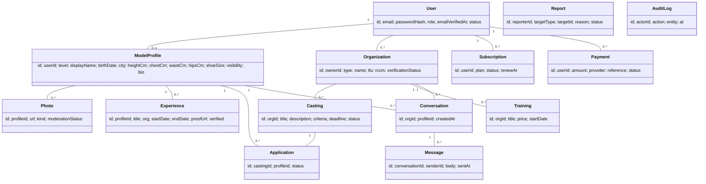
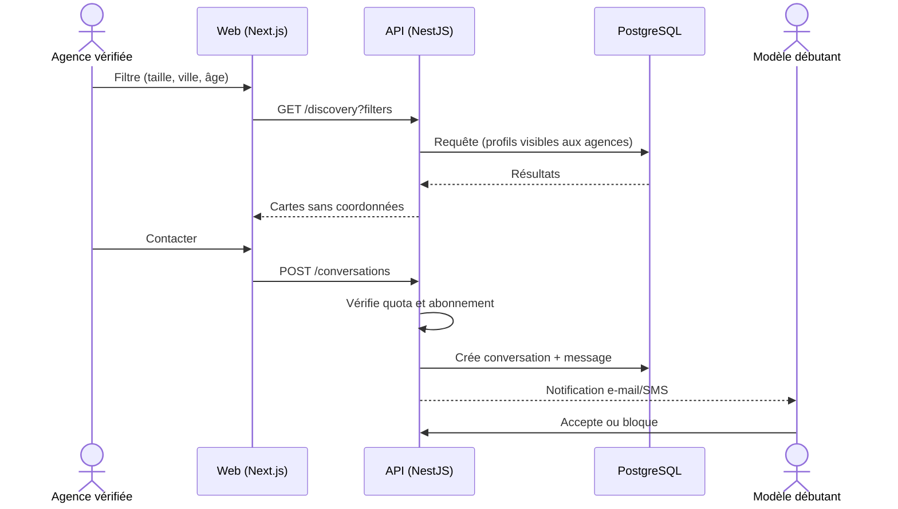

# ModelBénin — Dossier de conception complet

*Nom de travail, à remplacer. Version 1.0 — 9 octobre 2026. Auteur : Jona.*

## 1. Vision et ajustements de l'idée

**Mission** : devenir le point d'entrée national pour les jeunes qui veulent faire du mannequinat ou du modèle photo, et la place de marché de confiance où agences, photographes et recruteurs les trouvent.

**Ce qui est retenu de ton idée** : compte unique, deux parcours (confirmés / débutants), contact par les agences et les organismes de formation.

**Ce que j'ai ajusté ou complété** :

- **Un seul modèle de profil, deux niveaux** : plutôt que deux plateformes, un profil avec un statut `DEBUTANT` ou `CONFIRME`. Un débutant évolue en confirmé quand il ajoute des expériences vérifiées. Moins de code, une vraie progression.
- **Photos de débutant « sans filtre »** : consigne guidée (3 photos obligatoires : portrait, plein pied face, plein pied profil, lumière naturelle, sans retouche) + mensurations. Les agences voient des photos fiables.
- **Confidentialité par paliers** : le débutant n'est **jamais public**. Seules les agences vérifiées le voient, et le contact passe par la messagerie interne (pas de numéro affiché).
- **Vérification des agences** : c'est le plus gros risque du projet (fausses agences, arnaques, prédateurs). Chaque agence est validée manuellement (RCCM/IFU, site, références) avant d'accéder aux profils.
- **Majeurs uniquement (18+) dans le MVP** : 18 ans est la majorité civile au Bénin, alors que les mineurs imposent consentement parental et obligations légales lourdes. À traiter en phase ultérieure avec un juriste.
- **Castings** : les agences publient des offres, les modèles postulent. Ça crée de l'activité des deux côtés, pas seulement la recherche.
- **Formations** : les organismes publient des formations ; les débutants s'y inscrivent. Source de revenu en commission.
- **Signalement et blocage** : indispensable pour la sécurité.

## 2. Acteurs et modélisation UML

### 2.1 Acteurs

| Acteur | Description |
| --- | --- |
| Visiteur | Non connecté ; voit la vitrine, les tarifs, les agences vérifiées, les modèles confirmés qui ont choisi la visibilité publique |
| Modèle débutant | Majeur, profil photos + mensurations, visible des agences vérifiées uniquement |
| Modèle confirmé | Portfolio, expériences, visibilité publique ou agences |
| Agence / Recruteur | Compte organisation vérifié ; recherche, castings, messagerie |
| Organisme de formation | Type d'organisation ; publie des formations |
| Administrateur / Modérateur | Valide agences, modère photos, traite signalements, gère les paiements litigieux |
| Passerelle de paiement (externe) | Mobile Money / carte |
| Service e-mail / SMS (externe) | Vérification, notifications |

### 2.2 Cas d'utilisation par acteur

| Acteur | Cas d'utilisation |
| --- | --- |
| Visiteur | Consulter la vitrine · Voir les tarifs · Créer un compte · Se connecter |
| Modèle (tous) | Vérifier son e-mail · Compléter son profil · Téléverser des photos · Régler la visibilité · Consulter et répondre aux messages · Bloquer / signaler · Souscrire un abonnement · Supprimer son compte et exporter ses données |
| Modèle débutant | Soumettre les photos guidées et mensurations · S'inscrire à une formation · Passer confirmé |
| Modèle confirmé | Gérer portfolio et expériences · Postuler à un casting · Acheter un boost |
| Agence | Créer l'organisation · Soumettre les justificatifs · Rechercher avec filtres · Mettre un modèle en favori · Contacter un modèle (quota) · Publier un casting · Gérer les candidatures · Souscrire un abonnement agence |
| Organisme de formation | Publier une formation · Gérer les inscriptions |
| Admin | Valider/refuser une agence · Modérer une photo · Traiter un signalement · Suspendre un compte · Voir les statistiques et revenus |

### 2.3 Diagramme de classes (simplifié)



### 2.4 Diagramme de séquence — une agence contacte un débutant



### 2.5 Autres diagrammes à produire dans ton rendu

Diagramme d'activité de l'inscription (inscription → vérification e-mail → choix du parcours → profil → modération des photos → visibilité), diagramme d'états du profil (`BROUILLON → EN_MODERATION → ACTIF → SUSPENDU`), diagramme de déploiement.

## 3. Fonctionnalités gratuites et payantes

| Fonctionnalité | Gratuit | Payant |
| --- | --- | --- |
| Compte et profil | Oui, 5 photos | Premium : 30 photos, vidéo courte |
| Visibilité aux agences | Oui | Premium : profil mis en avant dans les résultats |
| Candidature aux castings | 2 par mois | Premium : illimitées |
| Statistiques de vues | Non | Premium : qui a vu / favori |
| Badge « Profil vérifié » | Non | Paiement unique (vérification d'identité) |
| Boost de profil | Non | Achat ponctuel (7 jours en tête) |
| Agence : recherche | Limitée (aperçus) | Abonnement Agence : filtres avancés, favoris, listes |
| Agence : contacts | 3 par mois | Quota étendu selon le plan |
| Agence : castings | 1 actif | Publication à l'unité ou pack |
| Formations | Publication gratuite | Commission sur chaque inscription payante |
| Annonceurs / marques | — | Bannière sponsorisée, castings à la une |

**Grille de prix proposée (à valider par une étude de marché locale)** :

| Offre | Prix |
| --- | --- |
| Premium Modèle | 2 000 FCFA / mois ou 18 000 FCFA / an |
| Badge vérifié | 5 000 FCFA, une fois |
| Boost 7 jours | 1 500 FCFA |
| Agence Starter | 15 000 FCFA / mois |
| Agence Pro | 40 000 FCFA / mois |
| Casting à l'unité | 5 000 FCFA |
| Commission formation | 10 à 15 % |

Paiement via Mobile Money (MTN MoMo, Moov Money) et carte, avec un agrégateur local comme FedaPay ou KKiaPay. **Règle importante : on ne vend jamais un « accès garanti à un contrat ».** Le modèle ne paie pas pour être pris, il paie pour de la visibilité et des outils. Sinon la plateforme ressemble à une arnaque et crée un risque juridique.

## 4. Architecture technique

Je reste dans ta logique de stage (Next.js, architecture par features) et dans ta stack (NestJS, Prisma, NextAuth). Note : je n'ai pas le code de xurya et xpense-tracker sous les yeux dans cette conversation. Si tu me colles l'arborescence d'un des deux, j'aligne la structure à l'identique.

| Couche | Choix |
| --- | --- |
| Front | Next.js (App Router), TypeScript, Tailwind, React Hook Form + Zod, TanStack Query |
| Auth | NextAuth (Auth.js) avec sessions JWT courtes + refresh, e-mail obligatoire vérifié |
| API | NestJS (modules par domaine), validation Zod/class-validator, Swagger |
| Base | PostgreSQL + Prisma |
| Cache / files | Redis (rate limiting, files d'envoi e-mail/SMS) |
| Fichiers | Stockage objet compatible S3 (Cloudflare R2), URLs signées, redimensionnement serveur |
| Paiement | FedaPay / KKiaPay + webhooks signés |
| E-mail / SMS | Resend ou Brevo ; SMS OTP via un agrégateur local |
| Modération | File d'attente admin + détection automatique basique (nudité) via un service tiers en phase 2 |
| Hébergement | Front sur Vercel, API et base sur un VPS ou service managé, sauvegardes quotidiennes |
| CI/CD | GitHub Actions : lint, tests, déploiement |
| Monitoring | Sentry + logs centralisés + alerte disponibilité |

**Mobile** : le public cible est surtout sur téléphone. Le site doit être *mobile-first*. Une app React Native (ta spécialité) peut venir en phase 3 en réutilisant l'API.

## 5. Structure des fichiers

```
modelbenin/
├─ apps/
│  ├─ web/                          # Next.js
│  │  ├─ src/
│  │  │  ├─ app/
│  │  │  │  ├─ (public)/           # accueil, tarifs, agences, mentions légales
│  │  │  │  │  ├─ page.tsx
│  │  │  │  │  ├─ tarifs/page.tsx
│  │  │  │  │  ├─ confidentialite/page.tsx
│  │  │  │  │  └─ conditions/page.tsx
│  │  │  │  ├─ (auth)/             # connexion, inscription, vérification e-mail
│  │  │  │  ├─ (modele)/dashboard/ # profil, photos, messages, castings, abonnement
│  │  │  │  ├─ (agence)/agence/    # recherche, favoris, castings, messages, facturation
│  │  │  │  ├─ (admin)/admin/      # agences, modération, signalements, stats
│  │  │  │  ├─ api/auth/[...nextauth]/route.ts
│  │  │  │  └─ layout.tsx
│  │  │  ├─ features/
│  │  │  │  ├─ auth/               # components, hooks, services, schemas, types
│  │  │  │  ├─ profiles/
│  │  │  │  ├─ portfolio/
│  │  │  │  ├─ discovery/          # recherche et filtres
│  │  │  │  ├─ messaging/
│  │  │  │  ├─ castings/
│  │  │  │  ├─ trainings/
│  │  │  │  ├─ billing/
│  │  │  │  ├─ moderation/
│  │  │  │  ├─ notifications/
│  │  │  │  └─ admin/
│  │  │  ├─ shared/
│  │  │  │  ├─ components/ui/
│  │  │  │  ├─ hooks/
│  │  │  │  ├─ lib/                # apiClient, auth, formatters
│  │  │  │  ├─ config/
│  │  │  │  └─ types/
│  │  │  └─ middleware.ts          # protection des routes par rôle
│  │  └─ next.config.ts
│  └─ api/                          # NestJS
│     ├─ src/
│     │  ├─ modules/
│     │  │  ├─ auth/ users/ profiles/ photos/ organizations/
│     │  │  ├─ discovery/ conversations/ castings/ applications/
│     │  │  ├─ trainings/ billing/ payments/ reports/ admin/
│     │  ├─ common/                 # guards, filters, interceptors, decorators
│     │  ├─ config/
│     │  └─ main.ts
│     └─ prisma/
│        ├─ schema.prisma
│        ├─ migrations/
│        └─ seed.ts
├─ packages/
│  └─ shared/                       # schémas Zod et types partagés
├─ docs/                            # UML, cahier des charges, politique
├─ .github/workflows/
└─ docker-compose.yml
```

Chaque dossier de `features/` suit le même gabarit : `components/`, `hooks/`, `services/`, `schemas/`, `types/`, `index.ts`. Une feature n'importe jamais une autre feature directement : elle passe par son `index.ts`.

## 6. Sécurité

### 6.1 Authentification et accès

- Mot de passe haché avec Argon2id ; politique minimale de 10 caractères ; vérification contre mots de passe compromis.
- E-mail vérifié obligatoire avant toute action (comme ton backend BiblioTrack). Option OTP SMS pour les agences.
- Verrouillage progressif après échecs, rate limiting par IP et par compte (Redis).
- RBAC : rôles `MODELE`, `AGENCE`, `FORMATEUR`, `ADMIN`, vérifiés **côté API** (guards NestJS), jamais seulement dans le middleware Next.
- Admin protégé par 2FA obligatoire.
- Cookies `HttpOnly`, `Secure`, `SameSite=Lax`, rotation des refresh tokens.

### 6.2 Données et fichiers

- HTTPS partout, HSTS, chiffrement au repos de la base et du stockage.
- Mensurations, date de naissance et pièces d'identité : chiffrés au niveau colonne ou stockés dans un bucket privé séparé.
- Photos : bucket privé, **URLs signées à durée courte** ; pas d'indexation par les moteurs de recherche (`noindex` sur les profils débutants) ; filigrane sur les aperçus ; suppression des métadonnées EXIF (GPS) à l'upload.
- Contrôle des fichiers : type réel (magic bytes), taille maximale, antivirus, redimensionnement serveur.
- Sauvegardes chiffrées quotidiennes, restauration testée chaque trimestre.

### 6.3 Application

- Validation stricte de toute entrée (Zod côté front et API), requêtes Prisma paramétrées (pas de SQL brut).
- Protection OWASP Top 10 : XSS (échappement + CSP), CSRF, IDOR (chaque ressource vérifie son propriétaire), SSRF, en-têtes de sécurité (Helmet).
- Webhooks de paiement : signature vérifiée, idempotence, jamais de confiance au retour navigateur.
- Secrets dans variables d'environnement gérées, jamais dans Git ; dépendances scannées (Dependabot).
- Journal d'audit (qui a vu / modifié / exporté quoi) conservé 12 mois.

### 6.4 Sécurité des personnes (spécifique au domaine)

- Agences vérifiées manuellement avant tout accès aux profils ; badge visible.
- Pas de numéro ni d'e-mail partagés dans les messages tant que le modèle n'a pas accepté ; détection de mots-clés (demande d'argent, hébergement, photos dénudées) avec alerte modération.
- Bouton signaler / bloquer sur chaque profil et conversation ; suspension immédiate possible.
- Page de conseils anti-arnaque, rappel : **aucune agence sérieuse ne demande d'argent pour « sélectionner » un modèle**.
- Contenu sexuel ou nudité interdit ; modération humaine des nouvelles photos avant publication.

### 6.5 Conformité (Bénin)

Le traitement de données personnelles est encadré par le Code du numérique (loi n° 2017-20 du 20 avril 2018, modifiée par la loi n° 2020-35 du 6 janvier 2021) et supervisé par l'APDP. Il faudra : déclaration préalable du traitement auprès de l'APDP avant la mise en service (article 405 du Code), avec un régime éventuellement renforcé pour les photos et mensurations, à confirmer avec le juriste, registre des traitements, base légale (consentement explicite), droits des personnes (accès, rectification, suppression, opposition). **À faire valider par un juriste béninois avant le lancement.** Je ne suis pas avocat.

## 7. Cahier des charges

### 7.1 Contexte et objectifs

Le secteur du mannequinat au Bénin manque de structuration : les jeunes n'ont pas de canal fiable, les agences n'ont pas de vivier centralisé et les arnaques sont fréquentes. **Objectifs** : (1) centraliser l'offre et la demande, (2) sécuriser la mise en relation, (3) générer des revenus récurrents, (4) atteindre 5 000 profils et 50 agences vérifiées la première année.

### 7.2 Périmètre

**MVP (phase 1)** : comptes et rôles, profils débutants et confirmés, portfolio, recherche et filtres, messagerie, abonnements et paiements Mobile Money, back-office admin, modération, pages légales.

**Phase 2** : castings et candidatures, vérification d'identité (badge), formations, boosts.

**Phase 3** : ouverture aux 16-17 ans avec accord parental vérifié (après avis juridique), application mobile React Native, détection automatique d'images, API pour partenaires, multilingue (fon, anglais), extension sous-régionale.

### 7.3 Exigences fonctionnelles

| Réf. | Exigence |
| --- | --- |
| F1 | Inscription par e-mail ou téléphone, vérification obligatoire, choix du rôle |
| F2 | Parcours débutant : photos guidées, mensurations, ville, âge (18+), consentement explicite |
| F3 | Parcours confirmé : portfolio, expériences, liens, compétences (défilé, photo, publicité) |
| F4 | Réglage de visibilité : privé / agences vérifiées / public (confirmés seulement) |
| F5 | Recherche avec filtres : taille, âge, ville, mensurations, expérience, disponibilité |
| F6 | Messagerie interne avec quotas, blocage et signalement |
| F7 | Publication de castings, candidatures, suivi de statut |
| F8 | Abonnements, achats ponctuels, factures, historique de paiement |
| F9 | Formations : publication, inscription, paiement |
| F10 | Back-office : validation des agences, modération photos, signalements, statistiques |
| F11 | Notifications e-mail / SMS / in-app |
| F12 | Export et suppression des données du compte |

### 7.4 Exigences non fonctionnelles

- **Performance** : page principale sous 3 s sur 4G ; images optimisées (WebP/AVIF), chargement paresseux.
- **Disponibilité** : 99,5 %.
- **Accessibilité mobile** : conception mobile-first, usable sur petits écrans et connexions lentes.
- **Sécurité** : section 6 intégralement.
- **Évolutivité** : API stateless, stockage objet extensible.
- **Maintenabilité** : architecture par features, tests automatisés (couverture visée 70 % sur la logique métier).
- **Langue** : français, extensible.

### 7.5 Contraintes et risques

| Risque | Mesure |
| --- | --- |
| Fausses agences / prédateurs | Vérification manuelle, signalement, messagerie interne |
| Mineurs | 18+ obligatoire, contrôle date de naissance, vérification d'identité en phase 2 |
| Fuite de photos | Bucket privé, URLs signées, filigrane |
| Œuf et poule (pas de modèles sans agences, et inversement) | Lancer d'abord avec 5 à 10 agences partenaires et 200 modèles par démarchage |
| Paiement mobile instable | Agrégateur fiable, webhooks idempotents, relance |
| Conformité légale | Juriste + APDP avant lancement |

### 7.6 Planning indicatif

| Étape | Durée |
| --- | --- |
| Cadrage, maquettes, validation | 3 semaines |
| Développement MVP | 10 à 12 semaines |
| Recette, sécurité, juridique | 3 semaines |
| Lancement pilote (agences partenaires) | 4 semaines |
| Phase 2 | 4 à 5 semaines |

## 8. Devis estimatif

*Hypothèses : développeur freelance à 30 000 FCFA par jour-homme, 10 % d'imprévus, hors TVA. Tout est ajustable, c'est une base de discussion.*

| Module | Jours | Montant (FCFA) |
| --- | --- | --- |
| Cadrage, UX/UI mobile-first, maquettes | 12 | 360 000 |
| Authentification, rôles, vérification e-mail/SMS | 8 | 240 000 |
| Profils et portfolio (upload, traitement images) | 12 | 360 000 |
| Parcours débutant (formulaire guidé, consentement) | 6 | 180 000 |
| Recherche et filtres | 8 | 240 000 |
| Messagerie, quotas, notifications | 10 | 300 000 |
| Paiements Mobile Money et abonnements | 10 | 300 000 |
| Back-office admin et modération | 12 | 360 000 |
| Sécurité, journal d'audit, pages légales | 10 | 300 000 |
| Déploiement, CI/CD, monitoring | 5 | 150 000 |
| Tests, recette, formation de l'équipe | 8 | 240 000 |
| Gestion de projet | 8 | 240 000 |
| **Sous-total MVP** | **109** | **3 270 000** |
| Imprévus 10 % |  | 327 000 |
| **Total MVP** |  | **3 597 000** |
| Phase 2 : castings et candidatures | 10 | 300 000 |
| Phase 2 : vérification d'identité et badge | 6 | 180 000 |
| Imprévus 10 % |  | 48 000 |
| **Total phase 2** |  | **528 000** |
| **TOTAL général** |  | **4 125 000** |

**Coûts récurrents estimés (première année, à confirmer avec les offres réelles)** : hébergement front + API + base \~ 30 000 FCFA/mois ; stockage et bande passante \~ 10 000 ; e-mails et SMS \~ 10 000 ; domaine 12 000/an. Soit environ **600 000 FCFA/an**. Les frais des agrégateurs de paiement (estimés à 1,5 à 2,5 % en Mobile Money et environ 100 FCFA fixes par paiement par carte, d'après des comparatifs publiés en 2026 ; à confirmer par contrat avec FedaPay ou KKiaPay) s'ajoutent. Maintenance évolutive proposée : 15 % du coût de développement par an.

**Hors devis** : juriste (conseil et déclaration APDP), marketing et lancement, modérateurs humains, app mobile.

**Seuil de rentabilité indicatif** : avec 40 agences Starter (15 000 FCFA/mois) = 600 000 FCFA/mois, les coûts récurrents sont couverts dès le premier mois et le développement s'amortit en un an environ avec \~ 400 modèles Premium en plus.

## 9. Politique de confidentialité (projet)

*Version projet à faire valider par un juriste béninois avant publication. Les éléments entre crochets sont à compléter.*

**Dernière mise à jour : \[date\]**

### 1. Qui sommes-nous

&#91;ModelBénin\], édité par \[raison sociale\], \[adresse\], Cotonou, Bénin, immatriculée sous le n° \[RCCM/IFU\], est responsable du traitement de vos données. Contact : \[e-mail du responsable de la protection des données\]. Ce traitement fait l'objet d'une déclaration préalable auprès de l'Autorité de Protection des Données Personnelles (APDP), récépissé n° \[à compléter\].

### 2. Données que nous collectons

- **Compte** : nom, prénom, e-mail, téléphone, mot de passe (haché), rôle.
- **Profil de modèle** : date de naissance, ville, taille, mensurations, pointure, biographie, photos, vidéos, expériences professionnelles.
- **Organisations (agences, formateurs)** : nom de l'entité, numéro IFU/RCCM, justificatifs, représentant légal.
- **Paiement** : référence de transaction, montant, moyen de paiement. Nous ne stockons pas vos numéros de carte ni vos codes Mobile Money ; ils sont traités par notre prestataire de paiement.
- **Techniques** : adresse IP, appareil, journaux de connexion, cookies nécessaires.
- **Communications** : messages échangés sur la plateforme (conservés pour la sécurité et la modération).

### 3. Pourquoi nous les utilisons

| Finalité | Base légale |
| --- | --- |
| Créer et gérer votre compte, vous mettre en relation | Exécution du contrat |
| Afficher vos photos et mensurations aux personnes que vous autorisez | **Votre consentement explicite** |
| Vérifier les agences et votre identité, prévenir la fraude et les abus | Intérêt légitime / obligation légale |
| Traiter les paiements, émettre les factures | Exécution du contrat, obligation légale |
| Vous envoyer des notifications de service | Exécution du contrat |
| Améliorer le service (statistiques anonymisées) | Intérêt légitime |

### 4. Données sensibles et visibilité

Vos photos et mensurations sont traitées avec une protection renforcée. **Vous décidez de leur visibilité** : privé, agences vérifiées, ou public (profils confirmés). Vous pouvez la modifier à tout moment. Nous ne vendons jamais vos données. Vos profils ne sont pas indexés par les moteurs de recherche lorsqu'ils sont réservés aux agences.

### 5. Qui y a accès

Seules les personnes que vous autorisez, nos équipes de modération et d'administration (accès tracé), et nos sous-traitants techniques (hébergement, stockage, e-mail/SMS, paiement) tenus par des engagements de confidentialité. Nous pouvons communiquer des données aux autorités sur demande légale.

### 6. Transferts hors du Bénin

Certains prestataires peuvent héberger des données hors du Bénin. Nous nous assurons qu'un niveau de protection adéquat est garanti et que les formalités auprès de l'APDP sont effectuées.

### 7. Durée de conservation

- Compte actif : pendant toute la durée d'utilisation.
- Après suppression : suppression des photos et données de profil sous 30 jours ; sauvegardes purgées sous 90 jours.
- Données de facturation : 10 ans (obligation comptable).
- Journaux de sécurité : 12 mois.
- Comptes inactifs depuis 24 mois : avertissement puis suppression.

### 8. Vos droits

Vous pouvez à tout moment accéder à vos données, les rectifier, les exporter, vous opposer à un traitement, retirer votre consentement ou demander la suppression de votre compte, depuis votre espace ou par e-mail à \[adresse\]. Nous répondons sous 30 jours. Vous pouvez saisir l'Autorité de Protection des Données Personnelles (APDP) en cas de litige.

### 9. Mineurs

La plateforme est **réservée aux personnes de 18 ans et plus**. Si nous constatons qu'un compte appartient à un mineur, nous le supprimons.

### 10. Sécurité

Chiffrement des échanges et du stockage, accès restreints, journalisation, vérification des agences, modération des contenus. Aucun système n'étant infaillible, nous vous informons et informons l'autorité compétente en cas de violation de données.

### 11. Cookies

Cookies strictement nécessaires (session, sécurité). Mesure d'audience anonymisée uniquement avec votre accord.

### 12. Modifications

Nous vous informerons par e-mail de toute modification importante.

### Conditions générales d'utilisation (points clés à rédiger)

Interdiction de demander ou de proposer de l'argent en échange d'un contrat de mannequinat ; interdiction de contenus sexuels, de photos de tiers sans accord, d'usurpation d'identité ; règles de modération et de suspension ; absence de garantie de recrutement ; conditions d'abonnement, de remboursement et de résiliation ; limitation de responsabilité de la plateforme (elle met en relation, elle n'est pas partie aux contrats entre modèle et agence) ; droit applicable béninois.

## 10. Prochaines étapes recommandées

1. Valider les hypothèses (18+, grille de prix, nom de la plateforme).
2. Réaliser les diagrammes UML dans ton outil (les blocs Mermaid ci-dessus se collent directement dans mermaid.live).
3. Maquetter les écrans clés : inscription, parcours débutant, résultats de recherche, messagerie.
4. Rencontrer 5 à 10 agences pour valider le besoin et pré-signer des partenariats.
5. Consulter un juriste et préparer le dossier APDP.
6. Démarrer le MVP en commençant par `auth`, `profiles` et `portfolio`.

## Vérifications effectuées (12 octobre 2026)

| Point | Résultat | Source |
| --- | --- | --- |
| Loi applicable | Loi n° 2017-20 du 20 avril 2018 portant Code du numérique, modifiée par la loi n° 2020-35 du 6 janvier 2021 | [Digital Business Africa](https://www.digitalbusiness.africa/28-janvier-journee-mondiale-de-la-protection-des-donnees-escale-au-benin-bon-eleve-en-cybersecurite-selon-l-uit/) |
| Déclaration APDP | Obligatoire avant la mise en œuvre du traitement (article 405) | [Digital Business Africa](https://www.digitalbusiness.africa/28-janvier-journee-mondiale-de-la-protection-des-donnees-escale-au-benin-bon-eleve-en-cybersecurite-selon-l-uit/) |
| Majorité civile | 18 ans au Bénin ; le Code de l'enfant vise les moins de 18 ans | [FAOLEX, Code de l'enfant](https://faolex.fao.org/docs/pdf/ben161458.pdf) |
| Passerelles de paiement | FedaPay accepte MTN Mobile Money, Moov Money et Coris Money au Bénin ; frais Mobile Money d'environ 1,5 à 2,5 % | [Documentation FedaPay](https://docs-v1.fedapay.com/payments/payment-methods) · [Comparatif KKiaPay / FedaPay](https://kolonell.com/fr/blog/kkiapay-fedapay-benin-integration-marchand-cotonou-2026) |

Non vérifié : le texte intégral de la loi n'a pas été relu et le régime exact applicable aux photos et mensurations (données sensibles ou non) n'est pas confirmé. Les taux des passerelles viennent d'un comparatif tiers, pas des grilles officielles. Rien de tout cela ne remplace l'avis d'un juriste béninois.
